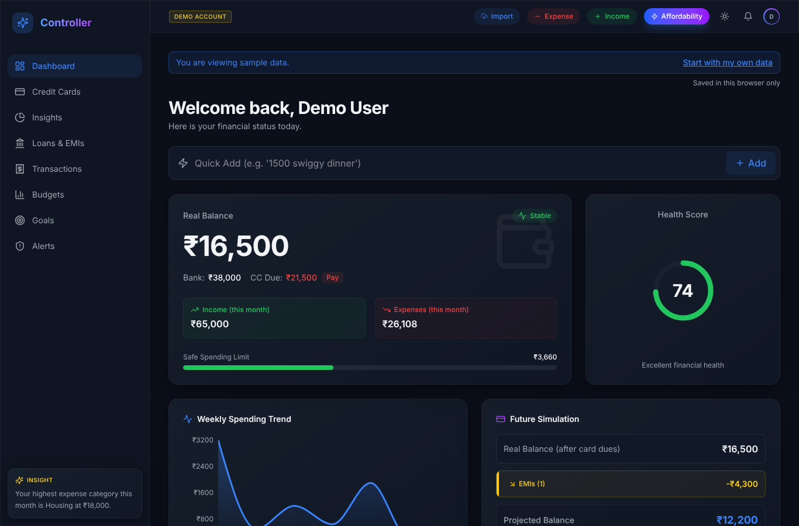
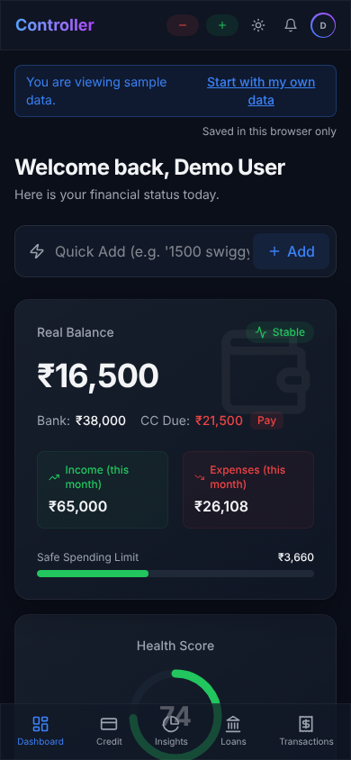

# Financial Controller

A personal-finance web app built around one question: **how much can I actually spend right now?**

Most expense trackers show what you spent. Financial Controller subtracts what you already owe (credit-card dues and this month's EMIs) and shows the money that is really free.

**Live demo:** https://financial-controller-theta.vercel.app (choose "Explore with sample data" to try it without an account)

| Dashboard | Loans & EMIs | Mobile |
| --- | --- | --- |
|  |  |  |

*Screenshots use the built-in sample data ("Explore with sample data").*

```
real balance            = bank balance − outstanding card dues
balance after EMIs      = real balance − EMIs still due this month
safe spending limit     = 30% of balance after EMIs (20% if no income is set), never below 0
can I afford X?         = safe if X ≤ safe limit; risky if X ≤ balance after EMIs; otherwise not recommended
```

## Features

| Area | What it does |
| --- | --- |
| Dashboard | Real balance, balance after EMIs, safe spending limit, health score (0–100), 7-day spending trend |
| Transactions | Cash or card expenses and income. Card expenses raise card usage instead of lowering the bank balance |
| Quick add | One-line entry such as `1500 swiggy dinner`, auto-categorised by whole-word keyword rules and user overrides |
| CSV import / export | Bank statements with Debit/Credit or Amount (+ Dr/Cr) columns. Day-first dates (`05/11/2026`, `05-Nov-2026`). Duplicates flagged; rows reviewed before saving |
| Can I afford this? | Checks a purchase against the safe limit and what is left after card dues and EMIs; shows card utilisation if paid by card |
| Loans & EMIs | "Pay EMI" books the instalment as a Loans expense, reduces the outstanding amount by the principal part (reducing-balance interest), counts down months, and stops counting that EMI as due for the month |
| Cards, budgets, goals | Card utilisation risk bands (<30%, 30–70%, >70%), one budget per category, savings goals with required pace |
| Alerts and insights | Rule-based alerts: low real balance, card utilisation >50% / >70%, budget at 80% / 100%, spending above income, EMI due, goal at 90%+ |
| Accounts | Supabase Auth: email/password, email OTP, Google OAuth, password reset |
| Storage | Signed in: per-user rows in PostgreSQL protected by Row Level Security. Signed out: this browser only |
| Sample data | "Explore with sample data" loads a realistic month, clearly labelled, never uploaded to an account |

Insights and categorisation are deterministic rules, not machine learning.

## Architecture

```
React UI ──▶ FinancialContext (useReducer: single source of truth for balance rules)
                 │
                 ├── lib/validation.ts    zod schemas mirroring the DB CHECK constraints
                 ├── localStorage         offline cache / signed-out mode
                 └── lib/sync/diff.ts     planSync(prev, next) → only changed rows
                          └── lib/sync/supabaseRepo.ts ──▶ Supabase (PostgREST) ──▶ Postgres + RLS
```

- **Sync.** After every change, `planSync` diffs the last state confirmed by the server against the new state. It upserts parents before children (cards before transactions) and deletes in the reverse order. Failed writes are kept and retried; the status bar shows "Saved to your account", "Saving…" or a retry prompt.
- **First sign-in.** If the account is empty, data already in this browser is uploaded once.
- **Security.** Responses send `X-Frame-Options: DENY`, `nosniff`, a strict referrer policy and a restrictive permissions policy. The client never sends `user_id`. Postgres fills it from `auth.uid()`, and every policy limits reads and writes to the caller's own rows. A transaction can only reference a card owned by the same user (composite foreign key).

## Database

`supabase/migrations/0001_finance_schema.sql` creates the isolated Financial Controller tables `fc_profiles`, `fc_transactions`, `fc_cards`, `fc_loans`, `fc_budgets` and `fc_goals`. Each financial row is scoped to a Supabase Auth user, has a composite `(user_id, id)` key, and is protected by forced Row Level Security. The migration also restricts table grants so the `anon` role has no direct table access.

**Legacy-data safety:** the migration intentionally does not alter the existing `public.users`, `public.income`, `public.transactions`, `public.cards`, `public.budgets` or `public.goals` tables. Those tables have a different schema. Existing legacy rows remain in place and are not automatically imported into the new app. A separate data-import migration requires a verified mapping from legacy `user_id` values to Supabase Auth users and confirmed transaction semantics.

Review the migration and take a database backup before applying it. It can be applied with the Supabase CLI (`supabase db push`) or in the SQL Editor. It fails closed if any of the new `fc_*` tables already exist, so inspect rather than rerun if it reports that they exist.

## Setting up Supabase (optional)

1. Create a project at supabase.com and copy its URL and publishable/anon key into `.env.local`.
2. Review and apply `supabase/migrations/0001_finance_schema.sql` once.
3. Under Authentication, enable Email (OTP) and, if wanted, Google, with the correct local and production redirect URLs.
4. Test sign-in, persistence, and two-user data isolation in a staging project before using production data.

A step-by-step checklist for the deployed site is in [docs/SUPABASE_SETUP.md](docs/SUPABASE_SETUP.md).

## Running locally

```bash
npm install
cp .env.example .env.local   # optional: without it the app runs in local-only mode
npm run dev
```

## Tests

| Command | What it checks |
| --- | --- |
| `npm test` | Unit tests: balance, EMI split and safe-limit maths, affordability, alerts and thresholds, reducer accounting (cards, EMI payments), CSV parsing and export, date formats, categorisation, validation, sync planning, row mapping |
| `npm run test:db` | Creates stand-in legacy tables, applies the migration to a disposable Postgres database, runs RLS tests, checks a second run fails closed and leaves the legacy tables' rows and columns untouched, then replays sync plans against the isolated schema |
| `npx playwright test` | Browser tests on a production build: dashboard figures, quick add, CSV import, EMI payments, affordability, onboarding, sample data, mobile navigation, account pages, guards and security headers |
| `npm run typecheck`, `npm run lint` | TypeScript and ESLint |

`test:db` needs `DATABASE_URL` pointing at a **disposable scratch database**. The helper drops and recreates the database named in that URL. Never point it at a production Supabase database. CI supplies a local Postgres 16 service and sets `DATABASE_URL` only on the dedicated database-test step.

## Known limitations

- The new schema migration and application calls still require staging verification against a real Supabase project. Local Postgres tests do not exercise Supabase Auth email delivery, OAuth redirects, or PostgREST itself.
- Legacy records in the old tables are preserved but are not imported into the new `fc_*` tables.
- Signing in on a device whose account already has data loads the account's data; anything entered on that device before signing in is not merged.
- Deleting a transaction, card, loan, budget or goal is immediate (no undo).
- Sync is last-write-wins per row. Editing on two devices at once can overwrite one device's change to the same row.
- Balance is stored as a running total updated by the reducer. Editing a transaction whose card was deleted treats it as a cash transaction.
- EMIs are paid with a button, not posted automatically on a due date, and there is no forecasting beyond the current month.
- Goal savings are tracked separately; adding to a goal does not move money out of the bank balance.
