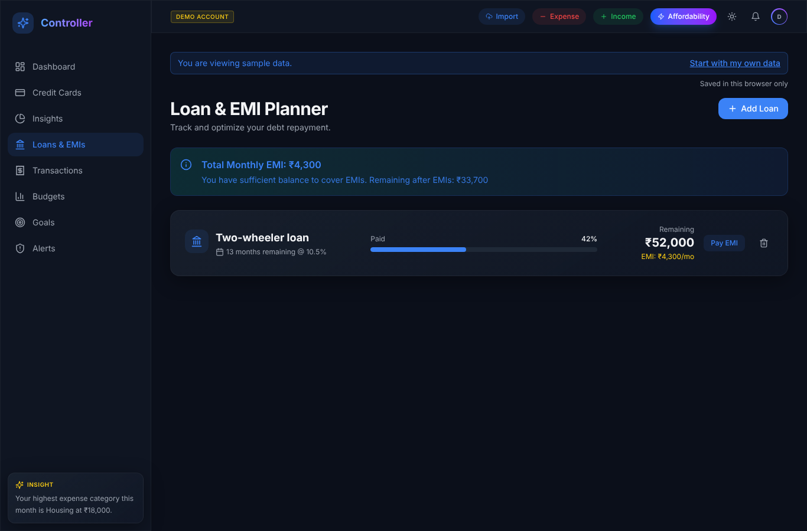

# Financial Controller

A personal-finance web app built around one question: **how much can I actually spend right now?**

Most expense trackers show what you spent. Financial Controller subtracts what you already owe (credit-card dues and this month's EMIs) and shows the money that is really free.

| Dashboard | Loans & EMIs | Mobile |
| --- | --- | --- |
|  |  |  |

*Screenshots use the built-in sample data ("Explore with sample data").*

```
real balance            = bank balance − outstanding card dues
balance after EMIs      = real balance − EMIs still due this month
safe spending limit     = 30% of balance after EMIs (20% if no income is set), never below 0
can I afford X?         = safe if X ≤ safe limit; risky if X ≤ balance after EMIs; otherwise not recommended
```

## Features

| Area | What it does |
| --- | --- |
| Dashboard | Real balance, balance after EMIs, safe spending limit, health score (0–100), 7-day spending trend |
| Transactions | Cash or card expenses and income. Card expenses raise card usage instead of lowering the bank balance |
| Quick add | One-line entry such as `1500 swiggy dinner`, auto-categorised by whole-word keyword rules and user overrides |
| CSV import / export | Bank statements with Debit/Credit or Amount (+ Dr/Cr) columns. Day-first dates (`05/11/2026`, `05-Nov-2026`). Duplicates flagged; rows reviewed before saving |
| Can I afford this? | Checks a purchase against the safe limit and what is left after card dues and EMIs; shows card utilisation if paid by card |
| Loans & EMIs | "Pay EMI" books the instalment as a Loans expense, reduces the outstanding amount by the principal part (reducing-balance interest), counts down months, and stops counting that EMI as due for the month |
| Cards, budgets, goals | Card utilisation risk bands (<30%, 30–70%, >70%), one budget per category, savings goals with required pace |
| Alerts and insights | Rule-based alerts: low real balance, card utilisation >50% / >70%, budget at 80% / 100%, spending above income, EMI due, goal at 90%+ |
| Accounts | Supabase Auth: email/password, email OTP, Google OAuth, password reset |
| Storage | Signed in: per-user rows in PostgreSQL protected by Row Level Security. Signed out: this browser only |
| Sample data | "Explore with sample data" loads a realistic month, clearly labelled, never uploaded to an account |

Insights and categorisation are deterministic rules, not machine learning.

## Architecture

```
React UI ──▶ FinancialContext (useReducer: single source of truth for balance rules)
                 │
                 ├── lib/validation.ts    zod schemas mirroring the DB CHECK constraints
                 ├── localStorage         offline cache / signed-out mode
                 └── lib/sync/diff.ts     planSync(prev, next) → only changed rows
                          └── lib/sync/supabaseRepo.ts ──▶ Supabase (PostgREST) ──▶ Postgres + RLS
```

- **Sync.** After every change, `planSync` diffs the last state confirmed by the server against the new state. It upserts parents before children (cards before transactions) and deletes in the reverse order. Failed writes are kept and retried; the status bar shows "Saved to your account", "Saving…" or a retry prompt.
- **First sign-in.** If the account is empty, data already in the browser is uploaded once.
- **Security.** Responses send `X-Frame-Options: DENY`, `nosniff`, a strict referrer policy and a restrictive permissions policy. The client never sends `user_id`. Postgres fills it from `auth.uid()`, and every policy limits reads and writes to the caller's own rows. A transaction can only reference a card owned by the same user (composite foreign key).

## Database

`supabase/migrations/0001_finance_schema.sql` creates `users`, `transactions`, `cards`, `loans`, `budgets` and `goals`, with RLS and CHECK constraints: positive amounts, valid types, remaining ≤ total, one budget per category, and card expenses only.

Apply it with the Supabase CLI (`supabase db push`) or paste it into the SQL editor.

## Setting up Supabase (optional)

1. Create a project at supabase.com and copy its URL and anon key into `.env.local`.
2. Run `supabase/migrations/0001_finance_schema.sql` in the SQL editor (or `supabase db push`).
3. Under Authentication, enable Email (OTP) and, if wanted, Google, with `http://localhost:3000` as a redirect URL.

## Running locally

```bash
npm install
cp .env.example .env.local   # optional: without it the app runs in local-only mode
npm run dev
```

## Tests

| Command | What it checks |
| --- | --- |
| `npm test` | 63 unit tests: balance, EMI split and safe-limit maths, affordability, alerts and thresholds, reducer accounting (cards, EMI payments), CSV parsing and export, date formats, categorisation, validation, sync planning, row mapping |
| `npm run test:db` | Applies the migration to a scratch Postgres and runs RLS tests (other users cannot read, update, delete or impersonate; anonymous sees nothing; invalid rows rejected), then replays sync plans against the real schema |
| `npx playwright test` | 12 browser tests on a production build: dashboard figures, quick add → budget alert, duplicate-budget rejection, CSV import of credits and debits, paying an EMI, affordability, first-visit onboarding, sample data, mobile navigation, account pages without Supabase, overpayment and past-deadline guards, security headers |
| `npm run typecheck`, `npm run lint` | TypeScript and ESLint, both clean |

`test:db` needs `DATABASE_URL` pointing at a **scratch** database (it is dropped and recreated). CI runs all of the above against a Postgres 16 service.

## Known limitations

- Not yet verified against a live Supabase project: sign-in emails, Google sign-in redirects and PostgREST writes. GitHub sign-in on `/auth` works only if the GitHub provider is enabled in Supabase.
- Signing in on a device whose account already has data loads the account's data; anything entered on that device before signing in is not merged.
- Deleting a transaction, card, loan, budget or goal is immediate (no undo).

- The Supabase calls in `supabaseRepo.ts` have not been run against a live Supabase project in CI. The schema, RLS and sync plans are tested on plain Postgres with a stand-in for `auth.uid()` (`supabase/tests/supabase_shim.sql`).
- Sync is last-write-wins per row. Editing on two devices at once can overwrite one device's change to the same row.
- Balance is stored as a running total updated by the reducer. Editing a transaction whose card was deleted treats it as a cash transaction.
- EMIs are paid with a button, not posted automatically on a due date, and there is no forecasting beyond the current month.
- Goal savings are tracked separately; adding to a goal does not move money out of the bank balance.
